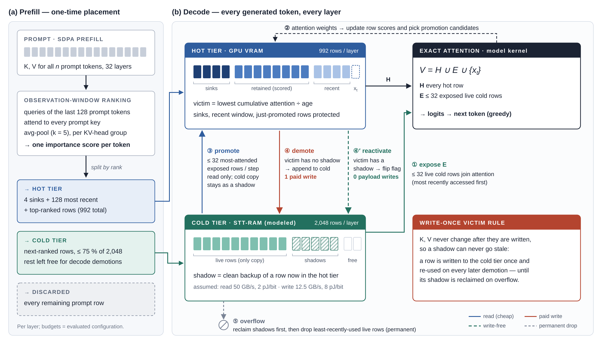

# Quick Summary: TieredKV, the 2-tier version

A talk script for the 27-slide deck `Thesis_presentation_2tier.pdf`. It replaces the older 3-tier Quick Summary. Every number below was checked against the raw evaluation outputs (see slide 25 and `docs/presentation/verification/`).

Suggested length: about 10 minutes plus questions.

---

## 1. The background: what is the KV cache? (1.5 minutes, slides 3–6)

"To understand our work, we first have to understand how large language models generate text. They generate it one token at a time. To predict the next token, the model has to look back at every token that came before it.

Recomputing all of that from scratch at every step would repeat a huge amount of work. So every model keeps a **KV cache** (Key-Value cache): it stores the intermediate 'Key' and 'Value' vectors of every past token. When the next word is generated, the model computes only the new token's vectors and reads the rest from the cache. A massive recalculation becomes a memory lookup."

## 2. The bottleneck: the problem statement (1.5 minutes, slides 7–10)

"But the cache grows with every token. For a long document or a long conversation it becomes enormous and fills the GPU's fast memory. Every generated token also has to re-read the whole cache, so decoding is limited by memory traffic, not by computation.

When GPU memory runs out, there are two common answers:

1. **Permanent eviction** (StreamingLLM, H2O, SnapKV). Keep only the tokens that look important and delete the rest. The flaw: a deleted token is gone forever. If a later question needs a fact that was deleted, the model cannot recover it.
2. **Keep everything and fetch selectively** (Quest). Nothing is lost, but the full cache still has to sit in GPU memory, so no capacity is saved.

Nobody keeps evicted tokens somewhere cheaper *and* designs for the cost of putting them there."

## 3. The key property and the memory we use (1.5 minutes, slides 11–12)

"Here is the property nobody uses: **once a token's K and V are written, they never change.** So a copy stored anywhere is always valid. There is no coherence problem and no dirty data.

That makes a token a perfect fit for **STT-RAM** (spin-transfer-torque magnetic RAM). STT-RAM is dense and non-volatile, uses very little standby power, and is cheap to read. Its weakness is writing: every write has to flip a magnetic layer with a current pulse, which is slower, costs more energy, and wears the cell. In our cost model we assume STT-RAM writes are 4× slower and 4× more energy per bit than its reads.

So the design rule is simple: **read the cold tier freely, but write to it as rarely as possible.**"

> Be precise if asked: no STT-RAM hardware was used. In the evaluation the cold tier is a GPU tensor. The STT-RAM speed and energy are **assumed prices** applied to the real event counts.

## 4. Our solution: TieredKV (3 minutes, slides 13–16)

"Instead of deleting tokens when the GPU fills up, TieredKV uses **two tiers**:

- a small, fast **hot tier** in GPU memory (992 rows per layer), and
- a larger **cold tier** modeled as STT-RAM (2,048 rows per layer).

Our earlier design had three tiers. Moving to a real model showed that the third tier never served a single read; it only delayed the deletion. So we removed it (slide 13)."

### The architecture diagram, explained simply (slide 14)

Read the diagram from left to right, then follow the numbered arrows.

**Left panel (a): what happens once, when the prompt is read.**

1. The whole prompt is processed and every token gets its K and V.
2. **Ranking.** The last 128 prompt tokens (usually the question) "look at" every earlier token. How much attention a token receives becomes its importance score. This is the SnapKV-style observation window.
3. **Split by rank** into three groups:
   - **Hot tier:** the first 4 tokens (attention sinks), the 128 most recent tokens, and the highest-ranked rest, 992 rows in total.
   - **Cold tier:** the next-ranked tokens, filling at most 75% of the 2,048 cold rows, so there is room left for later demotions.
   - **Discarded:** everything else.

**Right panel (b): what happens for every generated token, in every layer.**

- **① Expose.** Up to 32 cold rows, the most recently used ones, are added to attention. So the model reads all hot rows **plus** 32 cold rows plus the new token. Every method in the comparison attends to at most 1,024 cached rows per step.
- **② Feedback.** The model's own attention weights tell us which rows were actually useful. Each row's score is updated, and promising cold rows become promotion candidates.
- **③ Promote (blue arrow up).** Up to 32 of the most-attended exposed cold rows are copied into the hot tier. This is only a *read* from the cold tier. The cold copy is **not deleted**; it stays behind as a **shadow** (a clean backup).
- **④ Demote (red arrow down).** The hot tier is full, so a victim must leave. The victim is the row with the **lowest attention per step of age**. Sinks, the recent window and just-promoted rows are protected. If the victim has **no shadow**, it is written into the cold tier, which costs **1 paid write**.
- **④′ Reactivate (green dashed arrow).** If the victim **already has a shadow**, we write nothing. We just flip a flag and the shadow becomes the live copy again. That is **0 payload writes**. This is the whole trick, and it only works because K and V never change.
- **⑤ Overflow.** If the cold tier is full, shadows are reclaimed first. Only then are the least-recently-used live rows dropped permanently.

Box at the bottom right, the **write-once victim rule**: *a row is written to the cold tier once, and re-used on every later demotion.*

### The novelties in one line each

1. **STT-RAM as a cold victim tier**: evicted tokens are demoted, not deleted.
2. **Attention-driven exposure and promotion**: cold rows join attention every step, and the model's *real* attention decides what comes back to the GPU. There is no approximation in the loop.
3. **Write-once victim cache (shadows)**: a promoted token keeps its cold copy, so demoting it again is free.

## 5. Results (3 minutes, slides 17–23)

Setup: Mistral-7B-Instruct-v0.2, 6 LongBench tasks, 1,474 inputs, 7 configurations, **10,318 real predictions**, greedy decoding, 2× NVIDIA L40S.

| Method (6-task average) | Score |
|---|---|
| Full cache (no limit) | 41.79 |
| Upstream SnapKV (growing cache) | 39.80 |
| Official GQA SnapKV (growing cache) | 39.52 |
| **TieredKV, hot 1,024** | **38.81** |
| **TieredKV, hot 992 (same attended rows)** | **38.50** |
| SnapKV (adapted, fixed 1,024) | 33.80 |
| H2O (adapted, fixed 1,024) | 33.04 |
| StreamingLLM (adapted, fixed 1,024) | 32.12 |

What to say:

- **Accuracy (Fig. 1, Fig. 2).** At the same number of attended rows, TieredKV is **4.7 to 6.4 points** above the adapted 1,024-row baselines and the best compressed method on **all 6 tasks**. On TriviaQA it matches the full cache (87.3 vs 87.2).
- **Writes (Fig. 3).** During decoding, 4,959,926 cold-tier writes were paid and 52,587,210 were avoided by re-using shadows, so **91.4% of decode writes are avoided**. If you also count the initial placement of the prompt into the cold tier, the saving is **40.7%** pooled (26.1% averaged per task).
- **Costs, said openly (Fig. 4, Fig. 5).** TieredKV stores about **3× more KV** (398.5 MB vs 134.2 MB per request) and today decodes at **≈75–78 ms/token vs 23–34 ms** for the other methods, because the policy runs in Python after every layer.
- **Modeled traffic time and energy (Fig. 6, Fig. 7).** Decode energy is **1,455 J** for TieredKV vs 1,334–1,436 J for the compressed baselines and 16,784 J for the full cache. These use the assumed prices.
- **Policy behaviour (Fig. 8).** Promotions and demotions are of similar size, so the hot tier is constantly refreshed.

## 6. Honest positioning and conclusion (1 minute, slides 24–26)

"The official SnapKV, which lets its cache grow, scores 0.7–1.0 points **higher** than TieredKV. So we do **not** claim state of the art. What TieredKV shows is that a write-aware hierarchy keeps quality close to strong eviction methods, recovers tokens that eviction would lose, and avoids about **91% of decode-time writes** to the non-volatile tier.

Next steps: a fair, equal-memory comparison with the official SnapKV and newer methods; a fused GPU kernel to remove the latency overhead; and running the cold tier in real host memory instead of modeling it."

---

## Likely questions and short answers

- **"Is STT-RAM real here?"** No. The cold tier lives in GPU memory during the evaluation. STT-RAM time and energy come from assumed per-bit prices applied to real event counts.
- **"Isn't TieredKV getting more memory?"** Yes, more *total* storage (about 3×). The fair comparison is the hot-992 run, where every method attends to at most 1,024 rows per step.
- **"Why is it slower?"** The policy is Python/PyTorch running after every layer and needs the attention weights (eager attention). It is an engineering cost, not a property of the design. A fused kernel is future work.
- **"Is 91.4% the whole saving?"** It covers decode-time writes only. Including the initial prompt placement, it is 40.7%. Both numbers count logical writes, not physical device wear.
- **"Could the results be hard-coded?"** Every number was re-scored from the raw predictions with independent code (0 mismatches). 18 runs were re-executed on the GPU and gave identical tokens, scores and write counts.

## What changed from the old (3-tier) Quick Summary

| Old summary said | Now correct |
|---|---|
| 3-tier memory hierarchy | **2 tiers.** The third tier never served a read, so it became a plain drop. |
| Promotion via a "min/max bound sketch" (Quest-style) | Promotion uses the model's **real attention** on exposed cold rows. The sketch is no longer in the decode loop. |
| Old tokens are invisible until promoted | Up to **32 cold rows join attention every step**. |
| "Inclusive shadow cache" | Same idea, now called the **write-once victim cache** and measured: 91.4% of decode writes avoided. |
| "Winning on 5 out of 6 tasks" | Best compressed method on **all 6 tasks** at equal attended rows, **but** below the official SnapKV on average. No SOTA claim. |
| "As small as 1,024 tokens" | Hot tier 992 (or 1,024) rows **plus** a 2,048-row cold tier. Say that total storage is larger. |

## Figure numbers (renumbered 18 Nov 2026)

| Fig. | Slide | Shows |
|---|---|---|
| 1 | 18 | Accuracy at the same hot budget |
| 2 | 19 | Accuracy at the same attended rows (992 + 32) |
| 3 | 20 | Paid vs avoided cold-tier writes |
| 4 | 21 | KV storage footprint |
| 5 | 21 | Measured decode latency vs context length |
| 6 | 22 | Modeled traffic time |
| 7 | 22 | Modeled energy |
| 8 | 23 | Policy actions per task |
| 9 | not shown | Per-task score heatmap (backup slide material) |
